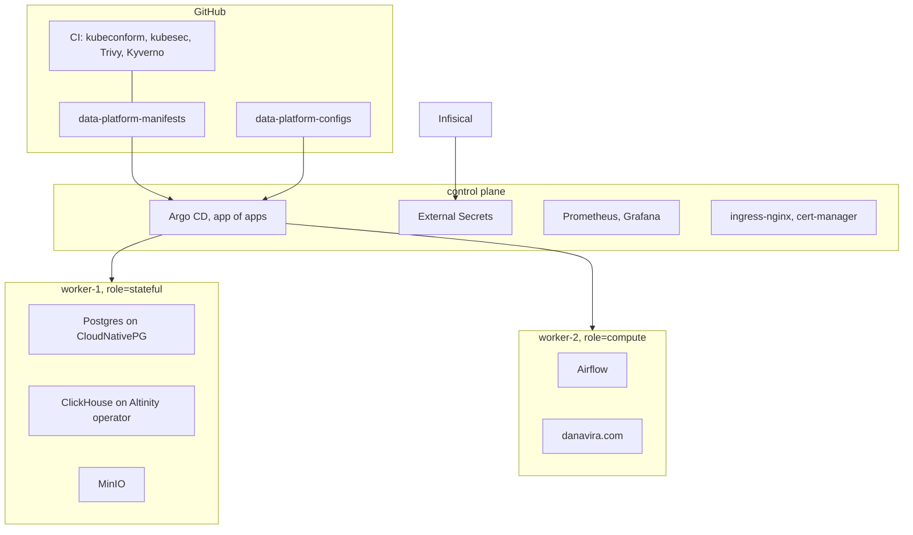

import ClusterMap from '../../../components/ClusterMap.astro';

## Context

At work I build pipelines on platforms someone else runs. I wanted to own the layer underneath: provision the machines, bring up Kubernetes, deploy stateful systems on it, and be the person who gets paged when it breaks.

So in March 2026 I rented three VPSs and turned them into a k3s cluster. It runs the data stack I use at work (Postgres, ClickHouse, Airflow, object storage), this site, and a few small personal apps. The rule from day one was no `kubectl apply` by hand: if it is in the cluster, it is in Git.

I also wrote things down as I went. Every significant decision has an ADR and every real outage has a postmortem, all public in [data-platform-docs](https://github.com/Danavira/data-platform-docs).

## Architecture

What is running right now, grouped by node. The map is rebuilt from the cluster's [Radar](https://sky.danavira.com) API every time this site deploys.

<ClusterMap />

How it fits together:

**Nodes have jobs.** The control plane runs cluster tooling: Argo CD, Prometheus and Grafana, ingress and cert-manager. The two workers are tainted by role. `worker-1` is `role=stateful` and holds the databases and object storage; `worker-2` is `role=compute` and runs Airflow and stateless apps. A workload only lands on a worker if it tolerates that taint, so a busy Airflow run cannot starve Postgres of memory.

**Three repos, three concerns.** `data-platform-manifests` holds Kustomize bases, Helm values and one Argo CD `Application` per component. A single app-of-apps `Application` discovers every `application.yaml` under `apps/` and `platform/`, so adding a component is one directory and one commit. `data-platform-configs` holds `ExternalSecret` objects: references to keys in Infisical, never values. `data-platform-docs` holds the reasoning.

**Order matters at boot.** The configs app syncs in wave 0 and everything else in wave 1, so secrets exist before the pods that mount them.

**CI runs before Argo CD sees anything.** Every pull request to the manifests repo renders all Kustomize and Helm output once, then runs it through kubeconform for schema errors, kubesec for risky pod specs, Trivy for misconfiguration, and 12 Kyverno policies: no `:latest` tags, allowed registries only, CPU and memory requests required, and no privileged, root or host-namespace pods. A last gate fails the PR if it touches cluster roles, namespaces, CRDs or ingress without a `platform-approved` label.

**Delivery for this site.** Every push to `main`, including a post saved in the CMS, builds a `sha-` tagged image to GHCR. Argo CD Image Updater picks the newest one, commits the tag to the manifests repo, and Argo CD rolls it out as two replicas, non-root, read-only root filesystem, all capabilities dropped. Nobody runs a deploy command, and Git still records every version that went live. cert-manager gets the certificate from Let's Encrypt through a Cloudflare DNS-01 challenge.

## Decisions and tradeoffs

**Argo CD over Flux, and over GitHub Actions running `kubectl`.** Flux would have done the job. I picked Argo CD for its UI, which shows sync state and drift at a glance when I am debugging at night. Plain CI-driven deploys were ruled out because they push once and then forget: nothing notices when the cluster drifts from Git. The cost is that Argo CD has to be bootstrapped by hand, and when it is unhealthy I am back to `kubectl`. ([ADR](https://github.com/Danavira/data-platform-docs/blob/main/adr/platform/argocd-gitops-deployment.md))

**Infisical with External Secrets over Vault or Sealed Secrets.** Vault is the stronger product but heavy to self-host for three nodes. Sealed Secrets keeps encrypted blobs in Git, so every rotation is a re-encrypt and a commit, and there is no audit trail. With Infisical and External Secrets, I rotate a value in one place and every namespace picks it up on the next poll. Pods only ever see ordinary Kubernetes Secrets. The tradeoff: Infisical is now on the boot path, and pods wait if their secrets have not synced. ([ADR](https://github.com/Danavira/data-platform-docs/blob/main/adr/platform/infisical-secrets-management.md))

**Operators for stateful systems.** Postgres started as a hand-written StatefulSet. I moved it to CloudNativePG for failover, backups and declarative users, and ClickHouse runs on the Altinity operator. The migration was the most painful change on this list (see below), and I would make it again.

**No sandboxed runtimes.** I looked at gVisor and Kata Containers and said no. Postgres, ClickHouse and MinIO are I/O-heavy, and both runtimes tax exactly that. The cluster is single-tenant and runs only images I build or pin, so I put the effort into pod security instead: drop all capabilities, run as non-root, use the `RuntimeDefault` seccomp profile, and block privilege escalation. I will revisit if it ever runs code I did not write. ([ADR](https://github.com/Danavira/data-platform-docs/blob/main/adr/platform/sandboxed-container-runtimes.md))

**Default-deny networking.** Every namespace starts with a default-deny policy and opens only what it needs: ingress from the ingress controller, scrapes from Prometheus, DNS and named egress. That is 50 NetworkPolicies across 14 namespaces. It has caught real mistakes, and it has also caused an outage of its own.

## What broke and how I fixed it

Seven postmortems so far. Three of them taught me the most.

**Airflow was down for 18 days and nothing said why.** ([PM-006](https://github.com/Danavira/data-platform-docs/blob/main/postmortems/pm-006-airflow-control-plane-missing-worker-route.md)) The scheduler, webserver and triggerer were all stuck waiting on database migrations. The migration jobs showed as running and logged nothing. They had been scheduled on the control plane, Postgres lived on `worker-1`, and the control plane had no flannel route or ARP entry for `worker-1`'s pod network. Packets were dropped before they left the node, so the connection hung without an error. Getting there meant first prying loose Argo CD hook jobs held by finalizers. Then I worked down from the application: is Postgres listening, is there a NetworkPolicy, which nodes are the two pods on, and what does each node's routing table look like. Adding the route and a permanent neighbour entry fixed it in seconds.

**The same bug, one layer earlier.** ([PM-005](https://github.com/Danavira/data-platform-docs/blob/main/postmortems/pm-005-worker-to-worker-flannel-arp-failure.md)) Weeks before, after re-provisioning the workers, pods on `worker-2` could not reach pods on `worker-1`. The flannel FDB entries were correct and the routes came back after a restart, but `tcpdump` showed nothing leaving `flannel.1`. `ip neigh` showed why: the neighbour entry for the other worker's VTEP was `INCOMPLETE`. I fixed both workers and wrote a checklist. The lesson from PM-006 was that I had only run that checklist on the workers. The control plane is a flannel peer too.

**A database migration that hit three bugs at once.** ([PM-007](https://github.com/Danavira/data-platform-docs/blob/main/postmortems/pm-007-cnpg-migration-network-policy-auth.md)) I shipped default-deny NetworkPolicies, CloudNativePG and a new Postgres client in one push. The import job could not reach the Kubernetes API. The host could, and a test pod in a namespace without policies could, which pointed at policy and not the firewall. The cause: k3s's policy controller does not combine several `Egress`-type policies in one namespace; it blocks all egress instead. Next, the operator could not probe its instances because nothing allowed port 8000. Last, every client failed to authenticate, because CloudNativePG had quietly replaced the superuser password with its own and reset any manual change. The fixes were one egress policy per namespace, an explicit ingress rule for the operator, and an `ExternalSecret` that feeds the Infisical password into CloudNativePG's `superuserSecret`. The bigger lesson was not to ship three risky changes in one commit.

Smaller ones: renaming the control-plane node orphaned every PersistentVolume pinned to the old name ([PM-001](https://github.com/Danavira/data-platform-docs/blob/main/postmortems/pm-001-control-plane-node-rename.md)). The Airflow chart's host was unreachable from the cluster, so I now mirror it to GHCR ([PM-002](https://github.com/Danavira/data-platform-docs/blob/main/postmortems/pm-002-airflow-oci-helm-repo-unreachable.md)). Docker Hub started returning 403s for anonymous chart pulls, so those charts now come from GHCR ([PM-003](https://github.com/Danavira/data-platform-docs/blob/main/postmortems/pm-003-clickhouse-helm-docker-hub-403.md)).

## Results

- **18 Argo CD Applications** deployed from one app-of-apps, across 14 namespaces, and about 180 commits to the manifests repo since March 2026. Apart from bootstrapping Argo CD itself, nothing in the cluster was applied by hand.
- **This site runs on it**, along with Postgres, ClickHouse, Airflow, MinIO, Grafana and a few small apps.
- **Every change is checked before merge** by four scanners and 12 Kyverno policies, 9 of them enforced.
- **Credentials live in one place.** Rotating a password is one edit in Infisical, with no commit or redeploy.
- **7 postmortems and 3 ADRs**, written at the time, in public.

What it gave me that work had not: debugging below the application. Before this I would have stopped at "the connection hangs." Now I check the routing table, the neighbour cache and the NetworkPolicy controller, and I know which one to suspect first.

### What I would do next

- Switch flannel from VXLAN to `host-gw`. The manual route and neighbour fixes do not survive a reboot, and all three nodes sit on one subnet, so the overlay buys nothing.
- Run the same Kyverno policies as an admission controller in the cluster, deployed through Argo CD, so they hold for anything that reaches the API and not just for pull requests.
- Add Loki for logs and turn Alertmanager on. Today I learn about an outage by noticing it, and that is how Airflow stayed down for 18 days.
- Fill in the ResourceQuotas that are still stubs, so one namespace cannot crowd out the rest.
