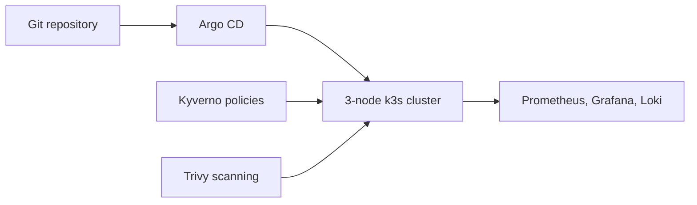

## Context

TODO(yasa): why you built it and what you wanted to practise or prove.

## Architecture

TODO(yasa): walk through the diagram above. The Mermaid block below is rendered to SVG at build time and is only a starting point built from the stack you listed.

## Decisions and tradeoffs

TODO(yasa): two or three choices, what you picked, what you gave up.

## What broke and how I fixed it

TODO(yasa): one or two real incidents, how you found the cause and what you changed.

## Results

TODO(yasa): what runs on it today and what you can now do that you could not before. Only numbers you can back up.
